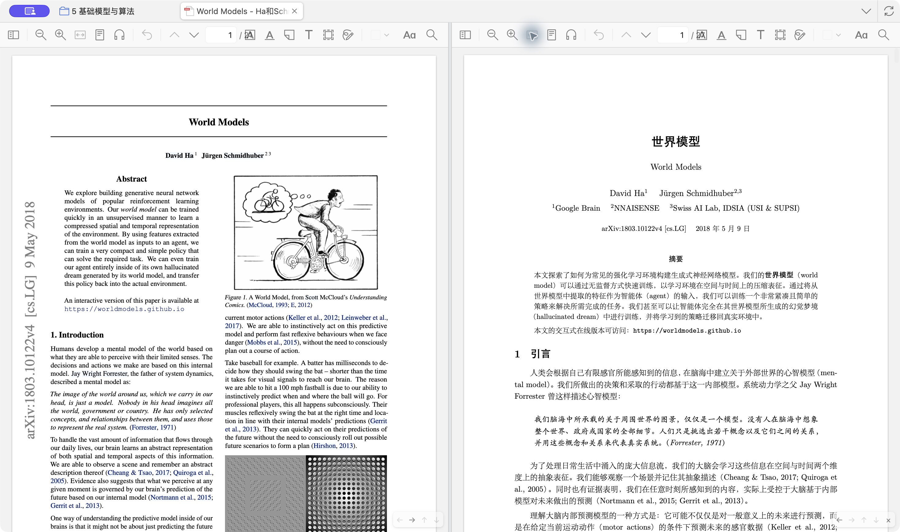
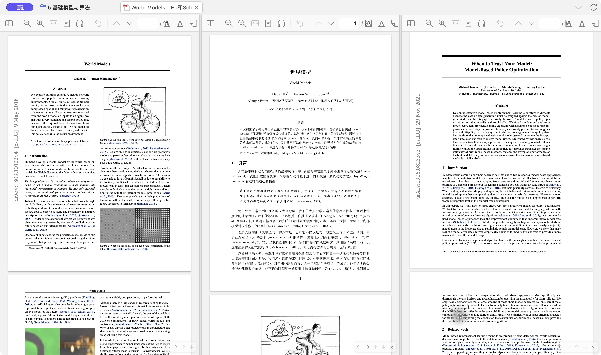
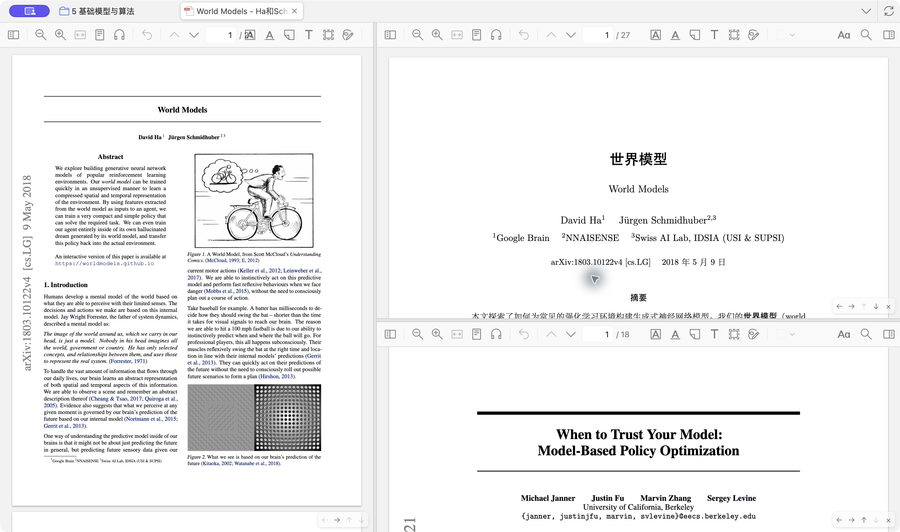
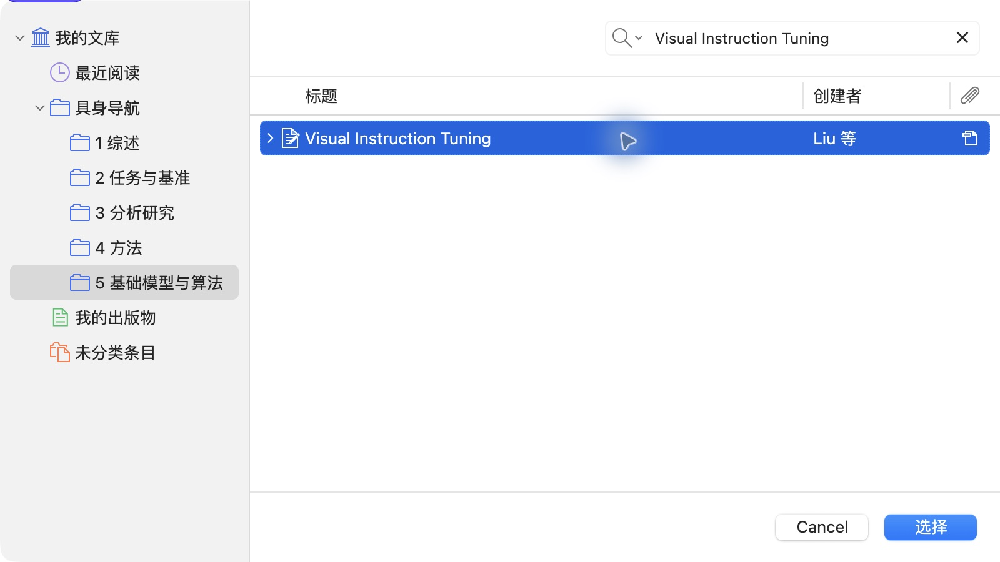
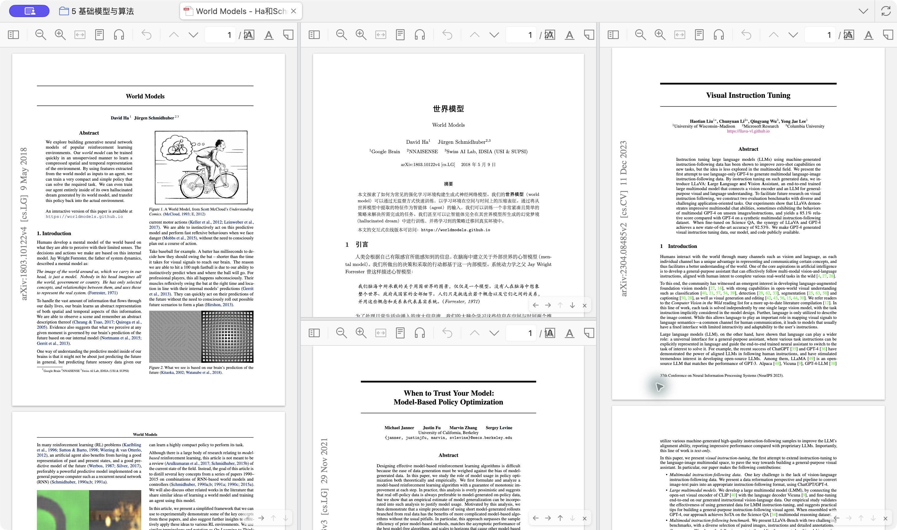

# Split Reader：Zotero 分屏阅读

在 **同一个阅读标签** 里同时打开多篇不同的 PDF（也支持 EPUB 和网页快照），最多 4 列、每列 4 格。适合原文和译文对照、几篇论文并排比较、一边读论文一边看它引用的那篇。

每一格都是完整的 Zotero 阅读器，可以各自翻页、缩放、搜索、做批注，批注照常保存到文献库。



## 功能

- **一起分屏打开**：在文库里选中几个条目，右键一次，就在新标签里排好。选中一个带多份 PDF 的条目（比如原文和译文），会把它下面的 PDF 全部摆开。
- **往已打开的标签里加一篇**：在文库里右键任意条目 →「分屏打开到」，或者在阅读标签上右键 →「添加分屏」→「从文库中选择…」。
- **网格布局**：最多 4 列 × 4 行。每格右下角有一个小工具条，可以移动或关闭这一格；分隔条横竖都能拖动。
- **布局会记住**：Zotero 自动卸载标签后再打开，或者重启 Zotero，布局都会照原样恢复。

| 往标签里加一篇 | 调整布局 |
|---|---|
|  |  |

| 从文库中选择… | 选好之后 |
|---|---|
|  |  |

## 安装

1. 从 [Releases](https://github.com/Naasi-LF/zotero-split-reader/releases/latest) 下载最新的 `split-reader-<版本>.xpi`。
2. 在 Zotero 里依次点：**工具 → 插件 → 右上角齿轮 → Install Plugin From File…**，选中下载的文件。

装好立即生效，不用重启。之后有新版本时，Zotero 会自动检查并更新。

**只支持 Zotero 10**。插件用到了 Zotero 阅读器的内部结构，Zotero 大版本更新后可能失效，所以限定了版本范围。目前只在 macOS 上测过。

## 用法

标签原来的那个阅读器叫「主阅读器」，其他格都是加进来的。

### 打开

| 在哪里右键 | 菜单项 | 效果 |
|---|---|---|
| 文库里选中 **几个条目**（2 到 16 个），或者 **一个带多份 PDF 的条目** | 一起分屏打开（N 个） | 新开一个标签，全部排好 |
| 文库里 **任意一个条目或附件** | 分屏打开到 ▸ *某个已打开的阅读标签* | 加进那个标签，然后切过去 |
| 阅读标签的 **标签页** | 添加分屏 ▸ 从文库中选择… | 弹出 Zotero 自带的条目选择框，可以搜索 |
| 阅读标签的 **标签页** | 添加分屏 ▸ *同一条目的其他附件 / 其他已打开的标签* | 快速选择。选的是已打开的标签时，那个标签会合并过来并关掉 |

- 「一起分屏打开」的排法：3 篇以内并排成几列；更多时排成接近正方形的网格，最多 4 列。比如 4 篇是 2×2，6 篇是 3 列每列 2 个，10 篇是 4 列。按行填：先填第一行，从左到右，再填第二行。顺序和条目列表里的顺序一致。
- 往已有的标签里加一篇时，默认在最右边新开一列；已经有 4 列时，放进格子最少的那一列的底部。
- 选中的是普通条目时，用它下面的第一个可读附件（优先 PDF）。
- 同一个附件不会同时出现在两个格子里：加到新位置时，会从原来的位置拿掉。

### 调整布局

每格右下角的小工具条（鼠标移上去会变清楚）：

| 按钮 | 作用 |
|---|---|
| ← → | 移到左边或右边那一列的底部。如果这一格已经在最边上那一列、而且这一列不止它一格，就新开一列 |
| ↑ ↓ | 和同一列里上下相邻的格子对调 |
| × | 关掉这一格。主阅读器那一格没有 ×，要关它就关掉整个标签 |

- 列和列之间、同一列上下格之间的分隔条都可以拖动，双击恢复等分。
- 阅读标签右键 →「关闭所有分屏」：只留下主阅读器。
- 某一格的附件被删除或移进回收站时，只关掉那一格。

### 能放几格

上限是 16 格（4 列 × 4 行），但实际能舒服阅读的格数取决于屏幕大小。每格都有自己的工具栏，宽度小于 500 像素左右时工具栏会显得拥挤。格子越多，同时运行的阅读器越多，占的内存也越多。笔记本屏幕上放 2 到 4 格比较合适。

## 已知限制

- 右边的条目信息栏和笔记栏只对应主阅读器的附件。
- 各格的阅读器侧栏（缩略图、批注列表）一起打开或关闭，因为 Zotero 每个标签只记一份侧栏状态。
- 标签页上显示的是主阅读器附件的标题。
- 把标签拖出去变成单独的窗口时，其他格不会跟过去。

## 原理

Zotero 的 `ReaderTab` 在构造时如果传入一个已经存在的标签 ID，会把新阅读器的 `<browser>` 追加到这个标签的容器里。插件就利用这一点：用主阅读器的同一个类，在同一个标签里再构造几个阅读器，并登记进 `Zotero.Reader._readers`。这样批注同步、主题切换、阅读位置保存都和普通阅读器一样工作。

`<browser>` 在页面里一换父元素，里面的阅读器就会被销毁重建，所以不能给每一列套一个容器。所有阅读器都留在标签容器里不动，用绝对定位按比例排成网格；分隔条和每格的小工具条也是绝对定位的覆盖层。

Zotero 只清理每个标签的第一个阅读器，其余格在关闭或卸载标签时由插件自己清理。加进来的阅读器在标签容器上挂了几个匿名监听器，没法移除，关掉一格时插件会把这些回调改成空操作，否则它们会去访问已经销毁的页面。另外，Zotero 在附件被删除时会调用阅读器的 `close()`，对阅读标签来说就是关掉整个标签；插件把加进来那些格的 `close()` 改成只关自己那一格。

布局保存在标签数据 `tab.data.splitReader` 里，所以 Zotero 保存会话时会一起存下来。

代码在 [`content/split-reader.js`](content/split-reader.js)，入口是 [`bootstrap.js`](bootstrap.js)。

## 开发

打包（生成 `build/split-reader-<版本>.xpi` 和自动更新用的 `build/updates.json`）：

```bash
./build.sh
```

发布时把这两个文件上传到 GitHub Release，tag 写成 `v<版本>`。

自动测试（macOS，需要安装在 `/Applications/Zotero.app` 的 Zotero 10）：

```bash
test/run-selftest.sh
```

脚本会新建一个临时的 Zotero 配置和临时文献库，直接加载源码目录，自动跑完所有功能，再重启一次检查会话恢复，全程不碰你自己的文献库：自测开始前会检查数据目录，不在临时目录里就直接退出。运行时会弹出一个 Zotero 窗口，跑完会自己关掉。结果在临时目录里的 `report1.json`（功能，40 项，包括开满 4×4）和 `report2.json`（重启恢复和旧记录迁移，5 项），旁边还有截图。

测试会把一种报错单独计数、不算失败："UNIQUE constraint failed: syncedSettings … lastPageIndex_"。这是 Zotero 自身的竞态问题：每打开一个阅读器，Zotero 都会先清空同步设置的缓存，再从数据库重新读取；这期间如果另一个阅读器正好在保存「上次读到第几页」，就会重复插入。后果只是那一次的页码没有保存，下次翻页会正常保存。

## 许可证

[MIT](LICENSE)
